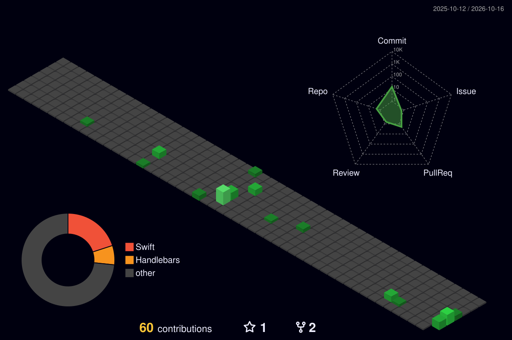

### Welcome to my GitHub Profile 👋

<!--
**portega017/portega017** is a ✨ _special_ ✨ repository because its `README.md` (this file) appears on your GitHub profile.

Here are some ideas to get you started:

- 🔭 I’m currently working on ...
- 🌱 I’m currently learning ...
- 👯 I’m looking to collaborate on ...
- 🤔 I’m looking for help with ...
- 💬 Ask me about ...
- 📫 How to reach me: ...
- 😄 Pronouns: ...
- ⚡ Fun fact: ...
-->
<!---->
<!---->

 # Top languages

- <a href="https://app.hackthebox.com/profile/1209733" target="_blank" rel="noreferrer">
        
         My HackTheBox Profile
    </a>
- <a href="https://tryhackme.com/p/Paabs" target="_blank" rel="noreferrer">
        
        My TryHackMe Profile
    </a>

## Languages and Technologies

<cbr>
  
  
  
  
  
  
  
  
  
  
  
  
  
  
  
  
  
 
  

  
<!---->

## Contact Me

<!--Visitor count 
  -->
